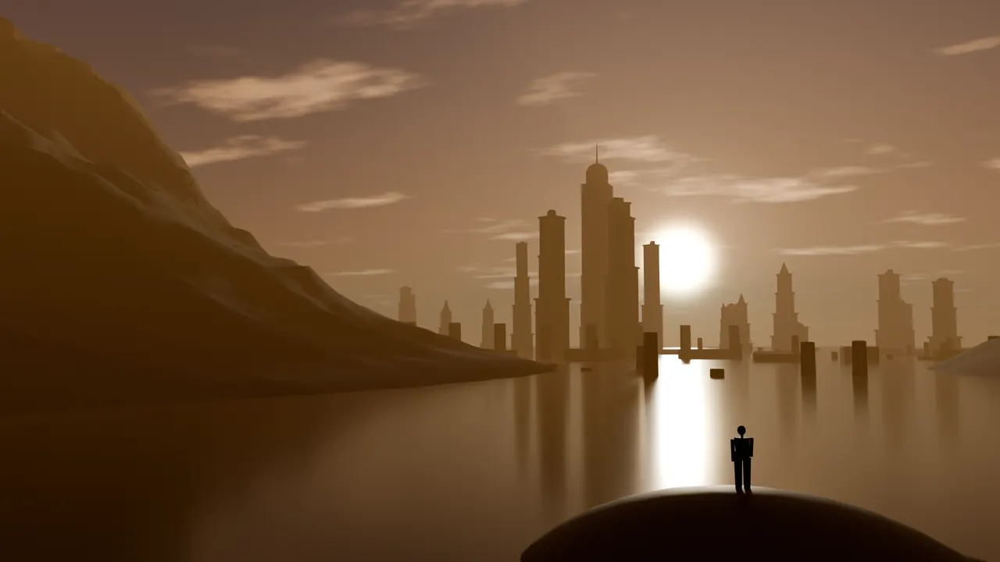

# GameCentral

Free games you can play in your web browser or download to your phone or computer.

## Pick a game

| Game | What it is | Play or download |
|---|---|---|
| **Meridian** | A 3D treasure-hunting adventure. Climb ruins, sneak past guards, solve puzzles and follow an old map to a drowned city. | **[Play in your browser](https://djbatalona06.github.io/GameCentral/)** · [Windows](https://github.com/djbatalona06/GameCentral/releases/latest) · [Mac](https://github.com/djbatalona06/GameCentral/releases/latest) · [Linux](https://github.com/djbatalona06/GameCentral/releases/latest) · [Android](https://github.com/djbatalona06/GameCentral/releases/latest) · [iPhone and iPad](games/meridian/docs/play-on-iphone.md) |
| **HeartBeat** | A life tracker for two people: look after a shared pet together, finish quests, share moods, workouts and calendars, and send each other nudges. | **[Open HeartBeat](https://heartbeat-eop.pages.dev/)** |
| **Duck Hunt** | A take on the classic duck-shooting game: three modes, 99 rounds, and it works without internet once it has loaded. | **[Play Duck Hunt](https://og-duxkhunt.vercel.app/)** |

All three run in any modern web browser. On a phone you can also add them to your Home Screen so they open like an app.

## Installing Meridian

**In a browser (any device):** open [the Meridian page](https://djbatalona06.github.io/GameCentral/) and press **Play**. After the first visit it works offline too.

**Windows, Mac or Linux:** go to the [download page](https://github.com/djbatalona06/GameCentral/releases/latest) and pick the file for your computer.
- **Windows:** `Meridian-Setup-…-windows.exe` installs the game. The `portable` file runs without installing. If Windows says it "protected your PC", choose **More info**, then **Run anyway** (the game is not signed by Microsoft yet).
- **Mac:** open the `.dmg` and drag Meridian into Applications. The first time, right-click Meridian and choose **Open**.
- **Linux:** download the `.AppImage`, allow it to run (right-click → Properties → "Allow executing"), then double-click it.

**Android:** on your phone, open the [download page](https://github.com/djbatalona06/GameCentral/releases/latest), tap `Meridian-android.apk`, and allow your browser to install apps when it asks.

**iPhone and iPad:** follow the [step-by-step iPhone guide](games/meridian/docs/play-on-iphone.md) (open the game in Safari, then **Share** → **Add to Home Screen**).

## Playing Meridian

Hold your phone sideways. Meridian works with touch, a game controller (Xbox, PlayStation or Switch) or a keyboard and mouse.

| | Touch | Keyboard and mouse | Controller |
|---|---|---|---|
| Move | Left thumb | W A S D or arrow keys | Left stick |
| Look around | Swipe on the right | Move the mouse | Right stick |
| Jump and climb | JUMP | Space | A / ✕ |
| Take cover or roll | COVER | Q | B / ○ |
| Use, grab, open | USE | E | Y / △ |
| Aim and shoot | AIM, FIRE | Right and left mouse button | Left and right trigger |
| Pause | II | Esc | Menu / Options |

You can change every button in **Settings → Controls**.

**Full screen on a computer:** press **F11** (or **Alt+Enter**), or use **Settings → Video → Full screen**.

**Help with seeing, hearing or moving:** the first time you play, Meridian offers ready-made setups for each. You can also change text size, subtitles, colours, high contrast, controls and much more in **Settings → Accessibility**. If your device is set to reduce motion or increase contrast, Meridian turns those on for you.

---

Making changes to a game? The developer notes are in [`games/meridian/README.md`](games/meridian/README.md).
