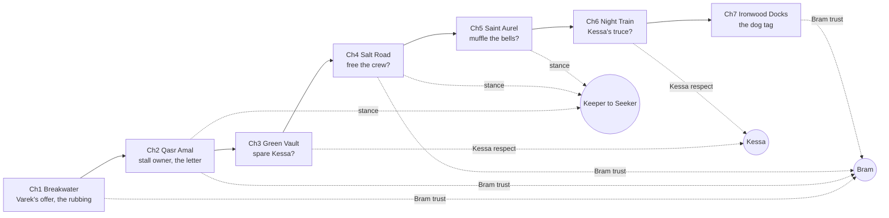
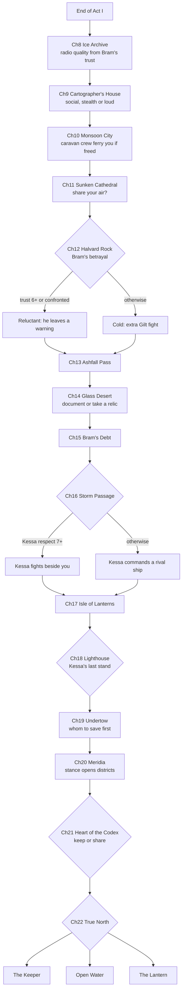

# Branching map

Choices change the numbers and flags; the chapters stay in order. Only the last act and the epilogue truly split.

## Act I (built): choices feed three values

## Acts II and III (planned): one decision beat per chapter, all converging

## Ending rules (`src/sim/story/Endings.ts`)
| Ending | When |
|---|---|
| **The Lantern** | stance is 3 or more (Seeker) and the player did not choose to keep Meridia hidden |
| **Open Water** | the player chose to share (`final:share`), Bram's trust is 7 or more and Kessa's respect is 5 or more |
| **The Keeper** | everything else, including every player who chose to keep Meridia hidden |

Each chapter's branch notes are in `src/sim/chapters/story/beats.ts`.
